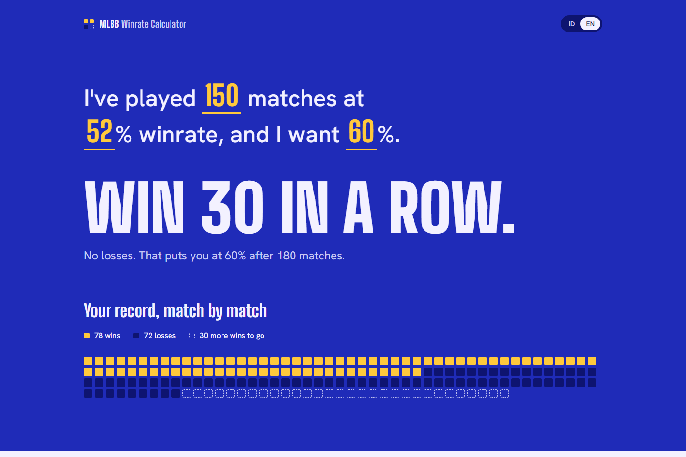
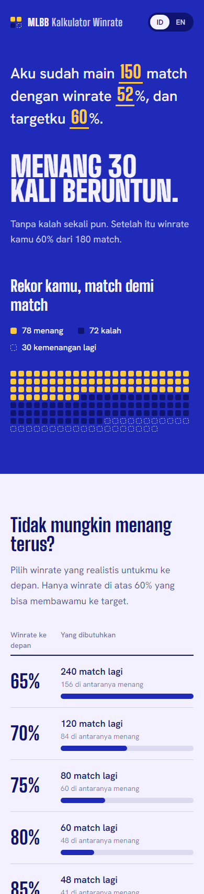

# MLBB Winrate Calculator

A bilingual (Indonesian / English) **Mobile Legends: Bang Bang** winrate calculator. Type your stats into a single sentence (matches played, current winrate, target winrate) and it tells you how many wins in a row you need, shows your whole record match by match, and maps out what it takes if you can't win them all. No accounts, no backend.


## Features

- **Sentence input**: the three stats are editable fields inside one sentence ("I've played 150 matches at 52% winrate, and I want 60%."). Results update as you type, and decimal commas like `52,5` work.
- **One clear answer**: a large headline with the win streak you need, plus where that streak leaves you.
- **Record ledger**: every match as a square: wins in gold, losses in navy, and the wins still to go as dashed outlines. Long records are grouped (one square = several matches) so the grid stays readable.
- **Already there?**: if you've hit your target, it shows how many losses in a row you can afford before dropping below it.
- **Realistic scenarios**: how many more matches you need at a forward winrate of 50% to 95%, with only the rates that can actually reach your target listed.
- **Projection chart**: your winrate across the streak (or across a losing streak once you've reached the target), with the target line and the crossing point marked.
- **Indonesian and English**: switch languages from the header. The choice is remembered, and numbers are formatted for each locale.
- **Shareable links**: inputs and language are kept in the URL, e.g. `?m=150&wr=52&t=60&lang=en`.
- **Clear errors**: impossible inputs (like a 100% target after a loss) explain what's wrong and how to fix it.

## How the math works

```text
currentWins = round(totalMatches * currentWR / 100)

// Wins needed assuming every additional match is won:
winsNeeded  = ceil((targetWR/100 * totalMatches - currentWins) / (1 - targetWR/100))

// Additional matches if you maintain a forward winrate f (only when f > target):
n = (targetWR/100 * totalMatches - currentWins) / (f/100 - targetWR/100)

// Once the target is reached, losses in a row you can afford:
buffer = floor(currentWins / (targetWR/100) - totalMatches)
```

## Tech Stack

- [React](https://react.dev/) + [Vite](https://vitejs.dev/)
- [Tailwind CSS v3](https://tailwindcss.com/)
- [Recharts](https://recharts.org/) (chart)
- Fonts: [Big Shoulders Display](https://fonts.google.com/specimen/Big+Shoulders+Display) and [Hanken Grotesk](https://fonts.google.com/specimen/Hanken+Grotesk)
- A small React context for translations, no i18n library
- Docker + Nginx for containerized deployment

## Clone the Repository

The project is mirrored on both GitHub and GitLab — clone from either one:

```bash
# GitHub
git clone https://github.com/willyrafaelfs/MLBB-winrate-calculator.git

# GitLab
git clone https://gitlab.com/willyrafaelfs/MLBB-winrate-calculator.git

cd MLBB-winrate-calculator
```

## Run with Docker

The app is built with Node.js and served as static files by Nginx in a lightweight container. Requires [Docker](https://docs.docker.com/get-docker/) with Docker Compose.

```bash
# Build the image and start the container in the background
docker compose up -d --build
```

Then open `http://localhost:8080`.

Common commands:

```bash
docker compose logs -f      # follow container logs
docker compose down         # stop and remove the container
docker compose up -d --build  # rebuild after code changes
```

Without Docker Compose:

```bash
docker build -t mlbb-winrate-calculator .
docker run -d -p 8080:80 --name mlbb-winrate-calculator mlbb-winrate-calculator
```

> To use a different port, change the left side of the port mapping (e.g. `"3000:80"`) in `docker-compose.yml`.

## Run Locally (without Docker)

Requires Node.js 20.19+ or 22.12+.

```bash
# 1. Install dependencies
npm install

# 2. Start the dev server
npm run dev
```

Then open the printed URL (usually `http://localhost:5173`).

To build for production:

```bash
npm run build      # outputs to /dist
npm run preview    # preview the production build locally
```

## Deploy to Vercel

1. Push this repo to GitHub.
2. Go to [vercel.com/new](https://vercel.com/new) and import the repository.
3. Vercel auto-detects Vite. Confirm the settings:
   - **Framework Preset:** Vite
   - **Build Command:** `npm run build`
   - **Output Directory:** `dist`
4. Click **Deploy**.

> No environment variables are required — the app is fully client-side.

You can also deploy from the CLI:

```bash
npm i -g vercel
vercel
```

## Screenshots

Desktop (English):



Mobile (Indonesian):



## Project Structure

```
MLBB-winrate-calculator/
├── src/
│   ├── components/
│   │   ├── Header.jsx           # Wordmark and language switch
│   │   ├── Hero.jsx             # Sentence input and the headline answer
│   │   ├── Ledger.jsx           # Match-by-match record grid
│   │   ├── Scenarios.jsx        # Matches needed at each forward winrate
│   │   ├── ProjectionChart.jsx  # Winrate projection chart
│   │   ├── Method.jsx           # "How it's calculated" disclosure
│   │   └── Footer.jsx
│   ├── lib/
│   │   └── calc.js              # Pure calculation helpers
│   ├── i18n.jsx                 # Indonesian / English strings and language context
│   ├── App.jsx
│   ├── main.jsx
│   └── index.css
├── Dockerfile                   # Multi-stage build (Node → Nginx)
├── docker-compose.yml           # Runs the app on port 8080
├── nginx.conf                   # Nginx config for serving the build
├── .dockerignore
├── index.html
├── tailwind.config.js
└── package.json
```

## License & Credit

MIT — free to use and modify.
- **Willy Rafael F. Silalahi**
- **GitHub:** [@willyrafaelfs](https://github.com/willyrafaelfs)
- **Email:** [willy.rafaelfs@gmail.com](mailto:willy.rafaelfs@gmail.com)